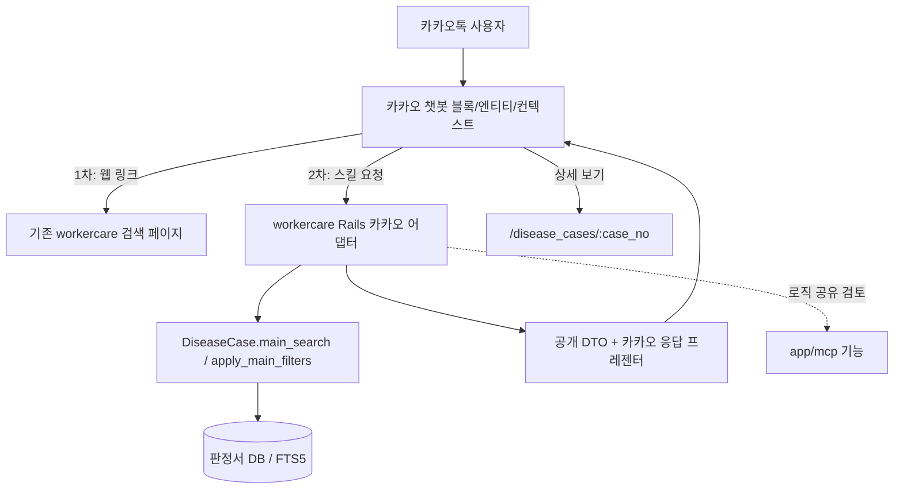

# 산재상담실 카카오톡 챗봇 개발 계획

- 버전: v0.6 (초안)
- 작성일: 2026-10-10
- 기준 저장소: https://github.com/Code-for-Korea/workercare
- 연계 기획서: [`project-plan.md`](project-plan.md)
- 변경 이력: v0.6 — 질병명을 `main_search` FTS(`q`)가 아닌 `disease_name` 필터로 검색, `result`·`disease_name` 필터를 `apply_main_filters`에 추가로 확정, `PIIMasking` 적용 범위 정정, 조합 검색 테스트 추가, 비식별 누락 대응 간소화.
- 변경 이력: v0.5 — `kakaotalk-review.md` 반영. 연계 링크·라우트 정정, 공개 DTO와 검색 매핑 확정, 검색 세션·로깅 설계 추가.

## 1. 개발 목표와 접근

기존 workercare의 판정서 데이터·검색 페이지·모델 검색 메서드를 재사용하고, 카카오 챗봇 관리자센터의 정적 블록·엔티티·되묻기·컨텍스트를 먼저 활용한다. 카카오톡 채팅창 내 동적 결과가 필요해질 때 최소한의 Rails 스킬 어댑터를 추가한다.

**원칙:** 문서에 언급된 구성은 코드로 확인된 것만 사실로 취급한다. 확인된 사실은 §3에 기록한다.

## 2. 목표 아키텍처



## 3. 0단계 — 저장소 실사 결과와 남은 확인

### 확인 완료 (2026-10-10, 현재 브랜치)

| 항목 | 사실 | 근거 |
|---|---|---|
| 상세 라우트 | `/disease_cases/:case_no` (`:id` 아님) | `config/routes.rb:6` |
| 식별자 | `case_no` (unique). `public_id` 없음 | `db/schema.rb` |
| 공개/검증 컬럼 | 없음. 데이터 전체가 비식별 완료 → 전체 공개 | 사용자 확인 |
| KCD 코드 | 컬럼 없음 (`disease_name`, `disease_category`만) | `db/schema.rb` |
| KSCO | `ksco_codes` 연관 (`disease_case_ksco_codes`) | `app/models/disease_case.rb` |
| 판정 결과 | `result` enum: `approved`, `rejected`, `partially_approved`, `revised_approved` | `disease_case.rb` |
| 근무기간 | `job_tenure_months` 컬럼은 있으나 검색 필터 없음 | `20260824000003_add_extracted_columns_to_disease_cases.rb` |
| 검색 진입점 | `DiseaseCase.search`(레거시, `result` 등 지원), `DiseaseCase.main_search` + `apply_main_filters`(구조화 필터) | `app/models/concerns/disease_cases/` |
| FTS 대상 | `main_search`의 FTS 컬럼은 `job_name`, `job_description`, `main_reasoning`, `other_harmful_factors`, `aggravating_factors`. `disease_name` 미포함, 폴백(`substring_job_fallback`)도 `job_name`/`job_description`만 LIKE | `main_searchable.rb:5-11, 111-132` |
| FTS 동기화 | insert/update/delete 트리거로 인덱스 자동 동기화 | `20260824000004_create_disease_cases_extracted_fts.rb` |
| 상세 `show` | `find_by(case_no:)` 후 nil 처리 없음. 뷰는 `detail_sections` 필드를 마스킹 없이 그대로 출력 | `disease_cases_controller.rb:26-28`, `show.html.erb:23-29` |
| 검색 로깅 | `log_search_event`가 `params[:q]` 원문을 기록 | `disease_cases_controller.rb:108-115` |
| 직렬화 | `as_safe_json`(`PIIMasking`)은 MCP 상세 리소스에서만 사용. 웹 상세·검색 화면은 미적용 | `disease_case.rb`, `app/mcp/resource_templates/` |
| 서비스 레이어 | `app/services` 없음. 검색 로직은 모델 concern | — |

### 남은 확인 대상

- 카카오 스킬 요청 JSON 구조(`userRequest`, `action`, `contexts`), 요청 인증·검증 수단, 응답 시간 제한, 카드·캐로셀 제한.
- 공개 웹 호스트, HTTPS, 상세 URL의 외부 공유 정책.
- 실제 데이터에서 `job_description`, `main_reasoning` 등 사용할 필드의 비식별 상태 표본 점검(비식별 누락 여부).

### 산출물

- `docs/chatbot/integration-inventory.md`: 위 확인 표의 확장판(메서드·파라미터·반환값).
- `docs/chatbot/data-field-map.md`: §5.3 매핑표의 확정본과 공개 DTO 필드 대응.
- 구현됨/계획/미구현 체크리스트.

### 완료 기준

로컬 또는 스테이징에서 대표 사례 1건을 `/disease_cases/:case_no`로 조회하고, `main_search`로 질병·직종 검색이 재현된다.

## 4. 1단계 — 카카오 관리자센터 기반 프로토타입(API 없이)

### 작업

1. 개발용 채널·봇 생성 및 연결 권한 확인.
2. `HOME`, `CASE_SEARCH`, `GUIDE`, `FALLBACK` 정적 블록 구성.
3. `disease_name`, `job_name`, `work_factor`, `decision_type` 엔티티와 동의어 CSV 준비.
4. 검색·안내·상세·조건 변경 발화 패턴 등록.
5. 되묻기(최대 2회 시범), 바로연결, 홈·뒤로/다시 검색 구성.
6. 기존 웹 검색의 **실제 지원 파라미터**(`q`, `job_name` 등 §5.3)로만 웹 링크 생성. 웹에 없는 파라미터는 사용하지 않는다.
7. 카카오 테스트 도구에서 발화 인식·폴백·링크 이동 검증.

### 산출물

별도의 `kakao-*.md`·`kakao-*.csv` 파일은 만들지 않고 [`chatbot.md`](chatbot.md)에 기록한다.

- [`chatbot.md`](chatbot.md): 블록 구성, 발화 패턴, 봇 테스트 시나리오, 엔티티 작업 기록과 진행 상태
- 엔티티 업로드용 CSV는 카카오가 파일로 받으므로 `docs/kakaotalk/entities/*.csv`에 둔다. 원본은 `config/chatbot/entities/*.yml` 사전이며 `bin/rails chatbot:entities:build`로 생성한다(자세한 내용은 `chatbot.md` §6).

### 완료 기준

사용자가 카카오톡에서 검색 조건을 선택하고 기존 검색 페이지에 도달하며, 결과가 없거나 이해되지 않은 질문도 홈으로 복귀할 수 있다.

## 5. 2단계 — Rails 스킬 어댑터와 채팅창 검색 결과

### 5.0 선행 코드 작업 (스킬 구현 전)

| 작업 | 내용 |
|---|---|
| `show` 보완 | `case_no`에 해당하는 레코드가 없으면 404를 반환한다. |
| 검색 로깅 정리 | `log_search_event`의 `query: params[:q]` 원문 로깅을 제거하거나 길이·해시로 대체한다(웹 포함). 별도 이슈로 분리해 먼저 처리한다. |
| 질병명·결과 필터 | `apply_main_filters`에 `disease_name`(LIKE 부분 일치, 기존 `job_name` 필터와 같은 `sanitize_sql_like` 패턴)와 `result`(enum 일치)를 추가하고 `main_search_params` 허용 목록에 넣는다. 챗봇은 `main_search` 한 경로만 호출하므로 모든 조건이 AND로 적용되고 FTS 폴백에서도 두 조건이 유지된다. 웹 검색 UI에 입력을 노출하지는 않는다. |

공개 스코프(`publicly_visible`)는 만들지 않는다. 데이터 전체가 비식별 완료 상태이기 때문이다. 웹 상세에 `PIIMasking`을 적용하는 일은 후속 과제로 둔다(§9).

### 5.1 권장 책임 분리

| 구성 요소 | 책임 |
|---|---|
| 카카오 블록 | 발화 인식·메뉴·조건부 되묻기·컨텍스트 |
| `Webhooks::KakaoController` (제안) | 스킬 요청 수신·인증·입력 검증·오류 처리 |
| `Chatbot::KakaoRequestAdapter` (제안) | 카카오 원본 JSON을 내부 검색 조건으로 정규화(한글 판정→enum 변환 포함) |
| `DiseaseCase.main_search` / `apply_main_filters` | 필터링·검색·정렬(기존) |
| `Chatbot::PublicCase` (제안) | 공개 DTO. 허용 필드만 직렬화 |
| `Chatbot::KakaoResponseBuilder` (제안) | 카카오 `version: 2.0` 응답 JSON 생성 |
| 기존 상세 페이지 | 긴 판정 이유·근거 표시 |

### 후보 라우트

```ruby
# 실제 라우트 충돌·보안 정책 검토 후 추가
post "/webhooks/kakao", to: "webhooks/kakao#create"
```

별도 공개 `/api/v1/cases/search`는 MVP 필수 사항이 아니다. 외부 API 공개가 필요해질 때 인증·호출량 제한·버전 정책을 별도로 설계한다.

### 5.2 공개 DTO (`Chatbot::PublicCase`)

현재 스키마에 존재하는 필드만 사용한다. 직렬화는 화이트리스트 방식이다. 비식별은 적재 단계의 책임이며, `PIIMasking`은 번호·이메일 형태만 바꾸는 보조 장치이고 `as_safe_json`의 고정 필드 목록에만 적용된다(`job_description`, `main_reasoning` 등 추출 컬럼은 해당 없음). 챗봇 DTO에서 마스킹을 쓸지는 구현 시 선택한다.

| DTO 필드 | 원본 | 비고 |
|---|---|---|
| `case_no` | `case_no` | 식별자이자 출처 표시 |
| `disease_name` | `disease_name` | |
| `result` / `result_label` | `result` | enum 값과 한글 라벨(인정·불인정·일부인정·변경인정) |
| `year`, `decided_on` | `year`, `decided_on` | |
| `job_name` | `job_name` | |
| `job_summary` | `job_description` | 마스킹 후 길이 제한(카드용) |
| `tenure_months` | `job_tenure_months` | 표시 전용 |
| `burden_body_part` | `burden_body_part` | 파이프 구분 값을 배열로 변환 |
| `reasoning_summary` | `main_reasoning` | 상세용. 마스킹 후 길이 제한, 길면 웹 링크로 유도 |
| `detail_url` | `/disease_cases/:case_no` | 질문 원문·사용자 식별자 포함 금지 |

삭제한 후보 필드: `public_id`(없음, `case_no` 사용), `evidence_verified`(공개/검증 플래그 없음), KCD(컬럼 없음), `worker_summary`(원본 필드 없음 — `job_summary`로 대체).

### 5.3 요청 계약과 검색 매핑

```json
{
  "intent": "case_search",
  "parameters": {
    "disease_name": "회전근개파열",
    "job_name": "자동차 부품 조립",
    "work_factor": null,
    "decision_type": "all"
  },
  "search_context_id": null
}
```

원문 발화(`utterance`)는 계약에 싣지 않고 파라미터 추출 후 폐기한다(§9).

| 계약 필드 | 변환 결과 |
|---|---|
| `disease_name` | `disease_name` (신규 LIKE 필터). `q`에 넣지 않는다 — FTS 대상 컬럼에 질병명이 없어 누락·0건이 된다 |
| `job_name` | `job_name` (LIKE) |
| `work_factor` | `q` (FTS: 업무 설명·판단 이유·유해 요인·악화 요인) 또는 `burden_body_part_text` (LIKE). 자유 텍스트이므로 정확 일치가 아니다 |
| `decision_type` | 한글→enum 변환: 인정→`approved`, 불인정→`rejected`, 일부인정→`partially_approved`, 변경인정→`revised_approved`, 전체→필터 없음. 알 수 없는 값은 무시하고 안내 |
| 근무기간 | 검색 조건에서 제외. 결과 표시로만 사용(필터 추가는 §10 후속 결정) |

### 5.4 검색 세션 설계 (`CASE_REFINE`)

- **저장:** 기본은 카카오 컨텍스트에 조건 JSON(`disease_name`, `job_name`, `work_factor`, `decision_type`, 페이지 번호)을 보관한다. 서버 저장이 필요한 경우(조건이 컨텍스트 크기 제한을 넘거나 페이지 이동 상태가 필요할 때)에만 `Rails.cache`(Solid Cache)에 TTL을 두고 저장한다.
- **식별자:** `search_context_id`는 추측 불가능한 불투명 랜덤 값(예: `SecureRandom.urlsafe_base64`). 카카오 사용자 식별자(`botUserKey`)는 저장 키에 평문으로 넣지 않고 해시해 소유권 검증에만 쓴다.
- **TTL:** 30분(카카오 컨텍스트 유효 시간과 맞춘다).
- **재사용 방지:** 요청의 사용자 식별 해시가 저장된 소유자와 다르면 거부하고 새 검색으로 안내한다.
- **만료·오류:** 만료·없는 ID는 `NO_RESULT`성 안내 + 새 검색·홈 바로연결로 복귀한다.
- **정리:** 캐시 TTL로 자동 만료. 별도 테이블을 쓰게 되면 일 1회 만료 레코드 삭제 잡을 둔다.
- **저장 내용:** 정규화된 조건만 저장하고 입력 원문은 저장하지 않는다.

### 5.5 내부 결과 계약(예시)

```json
{
  "status": "ok",
  "search_context_id": "opaque_random_id",
  "summary": {
    "total_count": null,
    "over_cap": false,
    "displayed_count": 0,
    "applied_filters": {}
  },
  "cases": [],
  "suggested_actions": ["refine_search", "new_search", "help"],
  "disclaimer": "검색 결과는 개인의 산재 승인 가능성을 의미하지 않습니다."
}
```

`cases`는 §5.2 공개 DTO 배열이다. `total_count`는 기존 검색과 같이 결과 상한 도달 시 `null`(`over_cap: true`)일 수 있다.

### 5.6 카카오 응답 구조 예시

```json
{
  "version": "2.0",
  "template": {
    "outputs": [
      {
        "simpleText": {
          "text": "조건에 맞는 판정 사례를 찾지 못했습니다. 검색어를 바꾸거나 조건을 줄여보세요."
        }
      }
    ],
    "quickReplies": [
      {
        "label": "조건 바꾸기",
        "action": "block",
        "blockId": "REPLACE_WITH_ACTUAL_BLOCK_ID"
      },
      {
        "label": "처음으로",
        "action": "block",
        "blockId": "REPLACE_WITH_ACTUAL_HOME_BLOCK_ID"
      }
    ]
  }
}
```

위 예시는 개념 확인용이다. `blockId`, 템플릿 필드 제약, 요청 검증 방법은 현재 카카오 스킬 문서와 관리자센터에서 확인한다.

### 5.7 구현 체크포인트

- 원본 카카오 요청의 `userRequest`, `action`, `contexts` 등 실제 구조 확인.
- 요청 인증·검증 수단, 비정상 요청 차단, 레이트 리밋 설계.
- 카카오 사용자 식별자와 내부 검색 세션 분리(§5.4).
- 상세 링크에 개인정보·원문 질문 포함 금지.
- 판정 결과 매핑(§5.3)과 테스트(네 가지 enum 값 보존).
- 카카오 스킬 응답 시간 제약 검증, 캐시·타임아웃·안전한 오류 응답.
- 응답은 공개 DTO(§5.2)로만 직렬화한다.

### 완료 기준

공개 데이터로 카카오톡 안에서 요약 결과를 확인하고, 웹 상세(`/disease_cases/:case_no`)로 이동할 수 있다. 결과 없음·오류·시간 초과·세션 만료도 정상 처리한다.

## 6. 3단계 — 상세 설명 및 산재 절차 안내

- 노동자 기본 요약: 쉬운 표현, 검토된 업무 요인, 확인할 자료.
- 상담 활동가 상세 보기: 질병명, 직종(연결된 KSCO가 있으면 함께), 근무기간, 판정 결과, 판단 이유(`main_reasoning`), 사건번호.
- 기존 MCP의 `compare_approval_factors`, `suggest_evidence`, `get_procedure_guide` 등은 실제 구현 상태를 확인한 뒤 내부 로직 공유를 검토한다.
- LLM을 쓰더라도 입력은 공개 DTO 범위로 제한하고, 근거 없는 판정 이유·승인 가능성·허위 인용을 생성하지 않는다.
- 산재 절차 안내에는 공식 출처·적용일·검토일을 연결한다.

## 7. 테스트 계획

### 기능 테스트

| 영역 | 테스트 |
|---|---|
| 발화 인식 | 질병명·직종명 동의어, 오타, 구어체 |
| 되묻기 | 누락값, 건너뛰기, 반복 실패, 유효시간 만료 |
| 검색 | 질병/직종 검색, 판정 결과 enum 변환(4종 + 전체), 미지원 조건(근무기간) 안내 |
| 조합 검색(회귀) | 질병명+직종+작업 요인 동시 입력 시 모든 조건이 AND로 적용, FTS 0건 폴백에서도 `disease_name`/`result` 유지, 정렬(bm25 vs 최신순), `over_cap` 시 `total_count: nil`, 단일 조건만 입력. 고정 시나리오 A(회전근개파열+자동차 부품 조립+어깨 작업), B(물류+허리디스크+불인정) |
| 맥락·세션 | 조건 변경, 홈 복귀, 재검색, 세션 만료, 다른 사용자 ID 재사용 거부 |
| 결과 표시 | 전체 건수·표시 건수·상한 도달 구분, 사건번호·링크, 카드 길이 |
| 안전 | 개인정보 입력, 비식별 누락 표본 점검, 승인 확률 질문 |
| 웹 | 없는 `case_no` 404, 검색 로그에 원문 질의 미기록 |
| 장애 | 검색 0건, DB 오류, 스킬 시간 초과, 잘못된 블록 ID |
| 모바일 | 실제 카카오톡에서 버튼·링크·캐로셀 표시 |

### 평가 세트

초기 100개 이상: 신청·절차 25, 판정 검색 30, 모호한 질문 15, 승인 예측·지원 불가 질문 15, 개인정보·보안 15. 검색 관련성·의도 추출·출처 정확성을 구분하여 측정한다. 정확도 목표는 베이스라인 측정 후 확정한다.

### 출시 차단 조건

- 응답·로그에 개인정보(비식별 누락 또는 입력 원문)가 남는다.
- 원문 근거 없는 판정 이유 생성.
- 승인 가능성을 확률·확정 판단으로 표현.
- 오류 시 복귀 불가 또는 반복적으로 응답 실패.
- 공식 절차 안내에 출처·적용 시점이 없거나 검토되지 않음.

## 8. 제안 일정(6주, 코드 실사 결과에 따라 조정)

| 주차 | 핵심 작업 | 완료 산출물 |
|---|---|---|
| 1주 | 실사 문서화, 공개 DTO·검색 매핑 확정, 선행 코드 작업(`show` 404, 로깅 정리) | 연동 목록·데이터 매핑·DTO 정의 |
| 2주 | 카카오 정적 블록·엔티티·발화·웹 링크 | API 없는 프로토타입 |
| 3주 | 스킬 요청 계약, Rails 어댑터, 검색 세션 | 요청/응답·세션 테스트 |
| 4주 | 검색 결과 요약·카드·상세 링크 | 채팅창 내 검색 MVP |
| 5주 | 절차 안내·상세 보기·오류 처리 | 통합 기능 |
| 6주 | 평가 세트, 개인정보(비식별 표본)·정확성 점검, 배포 | 공개 준비 및 운영 가이드 |

## 9. 배포·운영

- 개발 채널과 운영 채널을 구분하고 배포 전 관리자센터 테스트를 수행한다.
- **로깅:** 챗봇 경로는 요청 ID·블록/intent·오류 코드·결과 건수·처리 시간만 기록한다. 사용자 입력 원문과 추출된 자유 텍스트 값은 저장하지 않는다. 기존 웹 검색의 `params[:q]` 원문 로깅도 같은 기준으로 정리한다(§5.0).
- 장애 시 정적 도움말과 기존 웹 검색 페이지로 이동할 수 있도록 한다.
- 엔티티 CSV·발화·안내 문서의 버전을 Git에서 관리한다.
- 오류 신고 및 자료 정정 요청을 접수한다. 원본 데이터는 비식별이 완료되어 있으며, 예외적 누락이 신고되면 해당 `case_no`를 DB에서 수정·삭제한다. 검색·상세는 DB를 읽고 FTS는 트리거로 동기화되므로 즉시 반영되고, 챗봇은 사례 본문을 저장하지 않으므로 카카오 쪽 추가 조치는 없다.
- `PIIMasking`은 형태 기반 보조 장치로 MCP 경로에만 적용되어 있다. 웹 상세 적용 여부는 후속 과제.
- 카카오싱크·Event API·영구 대화 이력은 초기 범위에서 제외한다.

## 10. 착수 전 결정 사항

1. 검색 페이지로 연결하는 1차 버전을 먼저 공개할지, 스킬 카드 결과까지 구현 후 공개할지.
2. 근무기간 필터를 추가할지(기본: 후속). 웹 상세에 `PIIMasking`을 적용할지(기본: 후속).
3. 검색 세션 저장 방식 — 권장: 카카오 컨텍스트 + 필요 시 TTL 캐시(§5.4).
4. 웹 검색 로그에서 `q`를 완전히 제거할지, 길이·해시만 남길지.
5. 상담직원 연결 기능을 운영할 인력과 채널 설정.
6. 카카오 스킬의 최신 제한·인증 방식 및 응답 시간 초과 대응.

확정됨: 공개 범위는 비식별 완료 데이터 전체 공개(레코드별 공개 플래그 불필요). 판정 결과(`result`)·질병명(`disease_name`) 필터는 `apply_main_filters`에 추가(§5.0).

## 11. 참고 자료

- workercare: https://github.com/Code-for-Korea/workercare
- 카카오 스킬 가이드: https://kakaobusiness.gitbook.io/main/tool/chatbot/skill_guide
- 사용자 제공 카카오 챗봇 튜토리얼 1~3단계 및 제작 팁
- 리뷰: [`../../kakaotalk-review.md`](../../kakaotalk-review.md)
